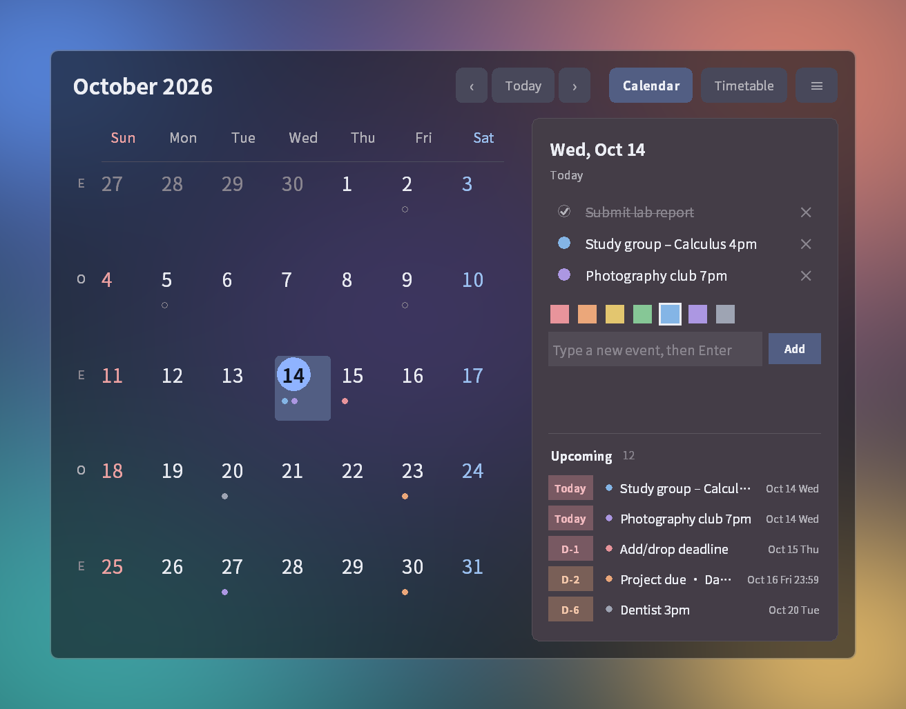
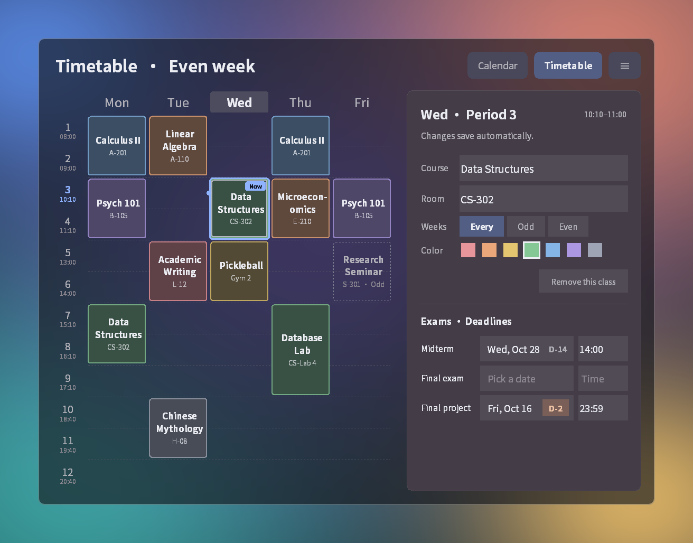
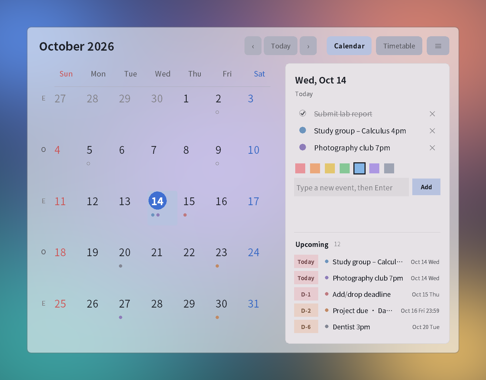
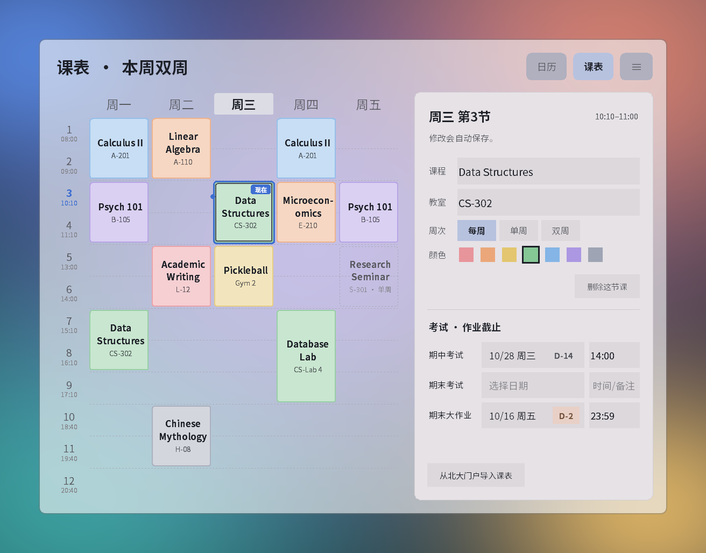

<div align="center">


# DeskCal

**Desktop calendar & timetable for PKU students**

[](https://github.com/HANSEIDON/DeskCal/releases/latest)

[](LICENSE)

[**⬇️ Download for Windows**](https://github.com/HANSEIDON/DeskCal/releases/latest)

</div>

DeskCal sits on your Windows desktop, just above the wallpaper. Deadlines, exams,
选课 dates and your weekly timetable are always one glance away. It runs fully offline
and needs no account.



## ✨ Features

- 📅 **Calendar with notes**: click a day and type. Color it, tick it off, edit in place.
- ⏰ **Upcoming deadlines** with D-day badges. Orange within a week, red for today and tomorrow.
- 🗓️ **Timetable**: Mon–Fri, 12 periods on PKU's schedule. The current class is highlighted.
- 🔁 **Odd / even weeks** (单周 / 双周). Classes not meeting this week are shown dashed.
- 📝 **Exam dates per course**: midterm, final and final project, shown in Upcoming.
- 🪟 **Always on the desktop**, even after Win+D. Frosted-glass look, dark and light themes.
- 🌐 **English / 한국어 / 中文**, with a bundled font so CJK text renders cleanly.
- 💾 **Autosave and Ctrl+Z.** Light on resources: about 100 MB of memory, near-zero idle CPU.



| Light theme | 中文 |
| --- | --- |
|  |  |

## 🚀 Install

> **Windows 10 / 11 only.** DeskCal uses Windows APIs and won't run on macOS or Linux.

### Option 1: Download the app (recommended)

1. Download `DeskCal-<version>-windows-x64.zip` from [**Releases**](https://github.com/HANSEIDON/DeskCal/releases/latest).
2. Extract it anywhere, for example into Documents.
3. Run **`DeskCal.exe`**. No Python or installer needed.

> [!NOTE]
> The exe isn't code-signed, so Windows may show **"Windows protected your PC"** on first
> launch. Click **More info → Run anyway**. Some antivirus tools also flag PyInstaller apps
> by mistake. If you prefer, run from source or [build the exe yourself](#building-the-exe).

<details>
<summary>Verify the download (optional)</summary>

Each release lists the zip's SHA-256 checksum. In PowerShell:

```powershell
Get-FileHash .\DeskCal-1.0.0-windows-x64.zip
```

The hash should match the one on the release page.
</details>

### Option 2: Run from source

1. Install [Python 3](https://www.python.org/downloads/windows/) with the default options.
2. Download this repo (**Code → Download ZIP**) or `git clone https://github.com/HANSEIDON/DeskCal.git`.
3. Double-click **`DeskCal.bat`**. No packages to install.

### Start with Windows

Turn on **≡ → Start with Windows**. This adds an entry to your user's `Run` registry key
(no admin rights needed). Turning it off removes the entry.

## 🖱️ How to use

| To | Do |
| --- | --- |
| Move the widget | Drag the title bar or the empty margin |
| Open settings | Click **≡**, or right-click the title bar or calendar |
| Add an event | Pick a day, type, press Enter |
| Complete / recolor | Click the dot / right-click the dot |
| Edit / delete | Click the title / click **×** |
| Undo | Ctrl+Z |
| Add a class | **Timetable** → click a cell → type the course name (saves automatically) |
| Odd / even-week class | **Every / Odd / Even** in the side panel |
| Exam dates | Select a class → **Exams · Deadlines** |
| Set which week is odd | **≡ → Odd / even week** |

The settings menu also has language, theme, background, size and *Always on top*. After two
idle minutes, the calendar jumps back to today.

## 💾 Your data

All data stays on your computer. Open the folder with **≡ → Open data folder**.

| Running | Data folder |
| --- | --- |
| `DeskCal.exe` | `%LOCALAPPDATA%\DeskCal` |
| From source | `data\` next to `deskcal.py` |

Every save keeps a `.bak` copy. Set `DESKCAL_DIR` to use a different folder.

<details>
<summary>Change the class period times</summary>

The default is PKU's 校本部 / 医学部 schedule (08:00–08:50 … 20:40–21:30). Quit DeskCal and
add 12 entries to `config.json`:

```json
{
  "periods": ["08:00-08:50", "09:00-09:50", "10:10-11:00", "11:10-12:00",
              "13:00-13:50", "14:00-14:50", "15:10-16:00", "16:10-17:00",
              "17:10-18:00", "18:40-19:30", "19:40-20:30", "20:40-21:30"]
}
```
</details>

<details>
<summary>Update or uninstall</summary>

- **Update:** quit DeskCal and replace the `DeskCal` folder with the new one. Your data is
  kept, because it's stored in `%LOCALAPPDATA%\DeskCal`.
- **Uninstall:** turn off **Start with Windows**, quit, and delete the `DeskCal` folder. To
  remove your data too, delete `%LOCALAPPDATA%\DeskCal`. DeskCal changes nothing else on
  your system.
</details>

## 🛠️ Development

A single file, `deskcal.py`, using tkinter and Win32 calls via `ctypes`. Only the standard
library is used.

```bash
python tests/test_deskcal.py        # unit tests (temporary folders, never your data)
python tests/real_input_check.py    # drives the real mouse and keyboard briefly
python tests/make_screenshots.py    # regenerates docs/ images from demo data
```

### Building the exe

```bash
python tools/build.py
```

This builds `dist/DeskCal-<version>-windows-x64.zip` and its `.sha256` file, using a pinned
PyInstaller version in an isolated `.build-venv`.

## 📄 License

[MIT](LICENSE). Bundled third-party components (Noto Sans CJK SC font, Python runtime,
Tcl/Tk, PyInstaller bootloader) are listed in [THIRD_PARTY_NOTICES.md](THIRD_PARTY_NOTICES.md).

DeskCal is an independent project and is not affiliated with Peking University.
